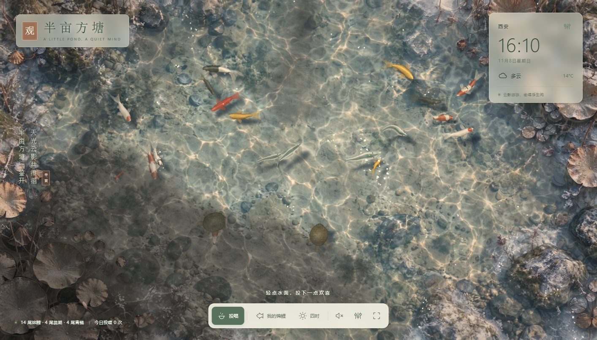
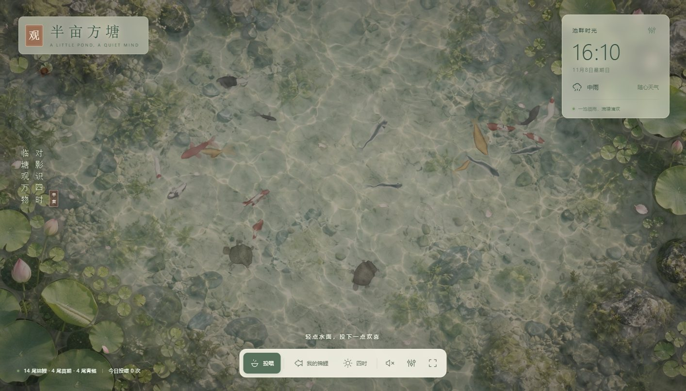
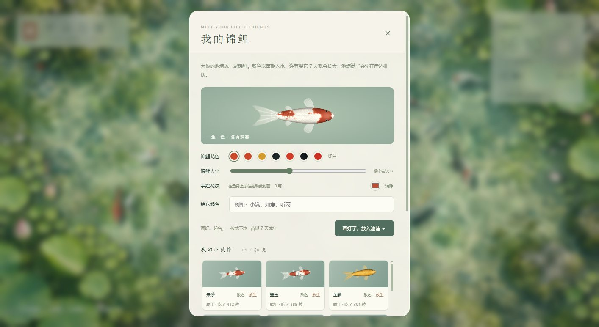

<p align="center"></p>

<h1 align="center">半亩方塘</h1>

<p align="center">半亩方塘作桌面：锦鲤悠游、云影掠过、雨打荷叶，轻点一下就来抢食。<br>
Windows · Android 动态壁纸，也能在浏览器和 Wallpaper Engine 里运行。</p>

<p align="center"><a href="https://github.com/lovest117/SkyPond/releases/latest"><b>⬇ 下载最新版本</b></a></p>



| 雨中荷叶特写 | 鱼影 |
| --- | --- |
|  |  |
| 雨中荷叶：叶心积起的一汪雨水、珠状水滴 | 晴天：鱼和乌龟在池底投下青绿色的影子 |

| 七种锦鲤花色与青鲢（逐片鳞片、圆钝的头部） | 池边石头上的小螃蟹 |
| --- | --- |
|  |  |

| 安卓桌面：轻点空白处投喂 | 安卓桌面：雨天 | 设为动态壁纸 | 应用内天气面板 |
| --- | --- | --- | --- |
|  |  |  |  |

## 下载

在 [Releases](https://github.com/lovest117/SkyPond/releases/latest) 获取对应平台的文件：

| 平台 | 预编译包 / 获取方式 | 说明 |
| --- | --- | --- |
| Windows 10 / 11 | `SkyPond-<版本>-Windows.zip`（Release 已提供） | 解压整个文件夹，双击包内的 `0-点我启动.bat`（或直接双击 `SkyPond.exe`）；通知区域锦鲤图标控制。若提示“已保护你的电脑”，点“更多信息 → 仍要运行” |
| Android 7.0+ | `SkyPond-<版本>-Android.apk`（Release 已提供） | 传到手机安装，允许「安装未知来源应用」；也可运行 `scripts/build-android-linux.sh` 自行构建，详见下方「安卓动态壁纸（APK）」 |
| 浏览器 / Wallpaper Engine | `SkyPond-<版本>-Web.zip`（Release 已提供），也可直接用源码 | 解压后打开 `index.html`，或导入含 `project.json` 的目录；本地也可 `npm run dev` |

> 当前 Release（v1.1.0）已提供 Windows / Android / Web 三个平台的预编译包与 `SHA256SUMS.txt` 校验和。Android 原生壳已完成品牌改名（包名 `com.skypond.koipond`、应用名「半亩方塘」）并打包四季背景图。

Windows 包内附了给不熟电脑的人看的两份东西：`0-点我启动.bat`（双击即开；万一只把 bat 拖出来、没解压整个文件夹，它会提示「整个文件夹一起解压」）和 `README.txt`（三步装好、用法、卸载与数据位置）。这两份文件是本次改动之后重新打包才带上的，已发布的 v1.1.0 旧包内没有，旧包直接双击 `SkyPond.exe` 即可。脚本只负责启动和提示，不会替你去动系统的「已保护你的电脑」拦截——那是绕过安全提示，交给用户自己判断；想先核验文件，用 Release 里的 `SHA256SUMS.txt`。

同一 Release 里还有两个**演示素材**（不是安装包，不能直接安装成锁屏或 AOD 主题）：`SkyPond-wallpaper-demo.mp4`（1080×1920 的动态壁纸实录，10 秒）、`SkyPond-AOD-demo.gif`（熄屏显示观感）。安卓的息屏显示由系统组件自行绘制，第三方应用无法向其中注入内容，这两个文件只是让你先看清楚效果再决定装不装。

iPhone：iOS 不允许第三方应用提供动态壁纸，因此没有 iPhone 版本；可以在 Safari 中打开网页版全屏观赏。

> 本作品基于开源项目「碧池观鱼」（[moli-xia/fishwallpaper](https://github.com/moli-xia/fishwallpaper)）二次创作：沿用其代码与素材，做了改名、平台调整与功能增补，非原作者官方版本。上游未声明开源许可证，本仓库不另外授予许可，引用或分发前请先联系原作者。

## 本地运行与开发

纯 HTML、CSS、WebGL2 和原生 JavaScript，无运行时依赖，不需要安装 npm 包；不支持 WebGL2 的环境自动退回 Canvas 2D。直接双击 `index.html` 可体验池塘；推荐通过本地服务运行，以获得稳定的本地存档和城市天气查询体验：

```sh
npm run dev
# 或
node scripts/serve.mjs
```

打开 <http://localhost:5173>。默认仅监听本机，`PORT=8080 npm run dev` 可更改端口。

## 已实现

- 水面：GPU 波动方程模拟涟漪（点击、投喂、雨点、鱼吻水面、乌龟换气、蜻蜓点水都会激起水波并互相干涉），折射水底与游鱼，动态焦散光网，细碎的太阳波光，天空反光。
- 云影：成团的云影随风飘过池面并缓慢变形。云影遮住之处水色转暗、偏冷偏灰，焦散、波光、鱼身高光随之消失，鱼影变淡变柔；云影移走，阳光、焦散与清晰的鱼影随即回来。多云时约半池云影、明暗交替；晴天偶有小片云影；雨天满天阴云。荷叶、石头、蝴蝶的影子同样受云影明暗影响。
- 鱼影：锦鲤、青鲢、鳍与乌龟在池底投下清晰的影子，水吸收红光使影子呈青绿色；贴底的鱼影深而锐利、靠得近，浮在水面的鱼影偏远、更柔和。
- 浮于水面的荷叶、荷花、花苞、铜钱草和出水的石头：按底图逐个标注并自动贴合边缘，从底图中切出单独绘制，不参与折射、焦散和波光，向水底投下阴影。荷叶随水漂动，铜钱草、花苞和荷花在茎上摇曳，风雨时摆得更明显，涟漪经过时会被推动；雨天被雨点打中时溅起水花并颤动，荷叶湿润后颜色更深，叶面挂满会反光的水珠，大荷叶中央积起一汪随叶倾斜晃动、不时泛起小圈涟漪的雨水，石头湿润发暗、雨水沿石面流下并映出天光；下雪时荷叶和石头上渐渐积起斑驳的雪，雪停后慢慢化去；涟漪遇到它们会被挡回，锦鲤可以从荷叶下游过。
- 锦鲤：程序化绘制的俯视贴图，含红白、大正三色、黄金、白写、丹顶、墨鲤、纯红七种花色。体形按真鱼俯视轮廓：圆钝的吻部明显窄于身体，最宽处在胸鳍与背鳍前端（约身长五分之二处），再收向粗壮的尾柄。每片鳞都有被前一片压住的暗色鳞袋、靠近游离缘的亮带和一道细细的鳞缘线，位置略有错落、色调各不相同，纯红、黄金、墨鲤这类纯色鱼也能看出一片片鳞；纯红背脊深红、两侧转为朱红，墨鲤是黑色鳞袋上罩着浅色鳞网。鳞片随身体弧度排布，花纹后缘沿鳞片呈扇贝状（kiwa）、前缘柔和（sashi），红斑中心深边缘浅；黄金锦鲤为温润的山吹黄金，墨鲤近乎哑光。身体按圆柱体实时受光，向阳一侧更亮，高光随转身移动。
- 游动：身体沿"头部带动的脊柱"弯曲，加速—滑行的节奏、平滑转向、结伴同游、互相避让、上浮下沉（越深越模糊、影子越近）、胸鳍随速度收放并在转弯时内侧张开；追食时减速对准，食物落在身下会先游开再绕回。
- 青鲢：4 条常驻池塘，瘦长鱼身、深青色背脊、银白侧身与白色腹缘，细尾柄连接深叉尾，胸腹鳍更窄；转向响应更快，后半身弯曲更灵活，以轻快的小幅摆尾加速和滑行，与锦鲤一起避让和受惊，松散结群巡游，不争抢投喂颗粒，也不占锦鲤名额或进入锦鲤食量榜。已有存档打开后也会出现。
- 24 尾初始锦鲤，点击投喂，一次 9 粒；鱼食漂浮、有上限和过期时间，入水溅起涟漪。「投喂」关闭时轻点水面会惊走附近的鱼。
- 创建锦鲤、调整大小与花色、随机花纹、手绘花纹、命名与改名、放生（二次确认，至少保留一尾）；最多 60 尾。
- 鱼苗养成：新放入的锦鲤以苗期入水，体长只有成年体长的 62%，连续喂满 7 个不同日子才成年（同一天喂多次不加速）；「我的锦鲤」列表里能看到「苗期 · 已喂 N/7 天」，成年后体长回到你选定的大小。
- 岸边排队：池塘满 60 尾后放入新鱼不再被拒绝，它先在岸边排队（最多 20 尾），你放生一尾就自动游进来，一次也不丢；排队名单和成长天数都随存档保存，换设备/重开浏览器都在。
- 食量榜并入「我的锦鲤」面板：在同一个面板里按累计进食数量排行，省掉一个入口；名字、手绘花纹、进食数据、每日投喂次数、设置自动保存在浏览器。
- 小螃蟹：红褐色的溪蟹和橄榄色的相手蟹，住在露出水面的石头和池边苔岸上。横着走、歇脚时举着螯、偶尔挥一挥；轻点附近时会飞快跑向水边钻进水里，过一会儿从别处冒出来。下雪时躲着不出来，可在设置中关闭。
- 小乌龟：四肢交替划水、歇息时探头张望、定时浮上水面换气；晴天蝴蝶（粉蝶、黄蝶、凤蝶）会停在荷花和荷叶上歇脚；红蜻蜓或碧伟蜓在晴天和多云时疾飞、悬停、停在荷花苞上、点水；夜晚换成萤火虫；荷花瓣在水面漂浮。
- 晴、多云、雨、雪，雨量与雪量可调（跟随城市天气时按实际降水、降雪量调整），切换时平滑过渡。雨丝分远近层次，雨点落水溅起小水花，池面飘过低低的雨雾；大雨时偶有闪电照亮池塘，雷声随后滚来（开启声音时；系统“减弱动态效果”时不闪电）。雪花分远近层次，随风飘移，落水后融化并泛起细纹。
- 四时面板（底栏第三项）：顶部是「此刻此地」卡片，下面才是手动档的四时。
  - 此刻此地：打开「跟着此刻此地走」后，按**当下时间与地点**自动定四季、昼夜、月相与天象——四季按四立节气切换（立春 2/4、立夏 5/5、立秋 8/7、立冬 11/7），昼夜按所选城市的日出日落分晨曦 / 晌午 / 斜阳 / 暮色，夜里按天文月龄取新月 / 弦月 / 满月（自动档不会给「星夜」），天象按当地实时天气。时间按城市所在时区算，不是设备时区。联动时下面的手动选项整体收起；点「手动接管」随时解耦，改过的值原样保留。
  - 定位尽力而为：拿不到位置就直接手填城市（Open-Meteo 地理编码），城市名与坐标记在本地，换城市后按新城市重算。天气同步失败时保留上一次的设定与快照（超过 20 分钟会在面板里注明「沿用 HH:MM 的快照」），不会凭空改季节或时段。
  - 手动档：四季（春 · 新荷 / 夏 · 盛荷 / 秋 · 残荷 / 冬 · 枯荷）、昼与夜并排的分段控件（选昼只出白昼四时段 晨曦 / 晌午 / 斜阳 / 暮色，选夜只出夜晚四相 新月 / 弦月 / 满月 / 星夜），天象（晴 / 多云 / 雨 / 雪）与雨雪量。切昼切夜会记住上一次选的具体时段，不会跳回晌午。
  - 换季不硬切：先压暗再换底图，回升时新图已经在了。
- 星夜：只在手动档可选，选中就没有月亮，池中不再映出月盘与月晕，只剩星光与水面碎影；夜里鱼游得更慢（约平时的 55%）、更常停在原地歇着，画面自动走节能档（30 帧、1 倍像素密度、更小的缓冲），更省电也更省内存。
- 查询并明确选择城市后使用 Open-Meteo 实时天气与日出日落，天气每 15 分钟更新，此刻每分钟校一次（只有时段、月相或季节真变了才重绘画面）。失败时保留原四时并提示，不伪造温度。
- 声音（全部由 Web Audio 实时合成，无音频文件，默认静音），总音量与各项音量分别可调：
  - 水声：溪流潺潺、山泉叮咚、叠水瀑声、池水轻漾、竹筒惊鹿，或关闭。
  - 天气环境音（不含水声、风声）：晴天鸟鸣与斑鸠；多云稀疏鸟鸣与布谷；雨天为雨声与雨滴落入池塘的叮咚声，随雨量变密，大雨时闪电过后传来雷声；雪天偶闻寒鸦；夜里虫鸣与蛙声。
  - 禅意音乐：古琴（拨弦模型、五声音阶、带滑音与泛音）、颂钵、风铃或关闭。
  - 互动水声：投喂、吞食、轻点水面。
- 30 / 60 帧模式、后台停止动画、移动端布局、键盘和沉浸模式。

## 操作

| 操作 | 效果 |
| --- | --- |
| 点击水面 | 投喂，或泛起涟漪并惊走附近的鱼（切换「投喂」按钮） |
| 我的锦鲤 | 选花色、直接在预览鱼身上手绘、起名，按「画好了，放入池塘 ＋」一次完成；放入后面板自动关闭，鱼以苗期入水。在列表中改名、放生；面板末尾是同一批鱼的食量榜 |
| 四时 | 顶部「此刻此地」按当下时间与城市自动定四时（可手动接管）；手动档切四季、昼四时段、夜四相（含「星夜」无月），再选天象与雨雪量，或查询并选择城市 |
| H | 隐藏 / 显示界面 |
| Esc | 关闭面板 / 退出沉浸 |
| 空格 | 水面获得焦点时，在中央投喂 |

手绘不再需要先开开关：打开「我的锦鲤」就能在预览鱼身上按住拖动直接画，右侧显示已画笔数；「清除」仅清除手绘笔触。存档按浏览器与来源隔离，`file://`、`localhost`、不同端口和 Wallpaper Engine 的存档互不共享。

## Wallpaper Engine

```sh
npm run build
```

构建结果位于 `dist/`，包含静态文件和 `project.json`。在 Windows 的 Wallpaper Engine 壁纸编辑器中选择「创建壁纸」，打开 `dist/index.html` 并保持其余文件的相对路径；如需直接打开项目，使用包含 `project.json` 的构建目录。

已经接入 `wallpaperPropertyListener`，支持宿主暂停与天气、雨量、雪量、速度、界面显隐、声音开关、水声开关与种类、天气环境音、禅意音乐和总音量属性。自定义属性定义在 `project.json`；若导入向导新建了项目配置，可在编辑器「更改项目设置」中重新添加 `weather`、`rainamount`、`snowamount`、`speed`、`showui`、`sound`、`water`、`watertype`、`weathersound`、`music`、`volume` 属性。

Wallpaper Engine 版本未在 Windows 宿主内运行验证。

## 检查与构建

```sh
node scripts/version.mjs check   # 版本号一致性，以 version.json 为唯一来源
npm test
npm run build
```

测试覆盖：追食和单次记账、食物落在身下也能吃到、长时间边界稳定性、游动姿态与体长、受惊逃离、避开荷叶、鱼食上限与过期、天气映射、异常存档清洗、手绘花纹持久化、纯红花色存档与像素颜色、青鲢混游与体形、各天气画面参数一致与云量、雨打荷叶的水花与颤动回稳、大雨闪电与雷声事件、鱼苗养成（同一天不重复计天、七天成年、老存档按成年兼容）、岸边排队进场顺序、四立节气边界、日出日落解析、昼四时段与入夜时刻、极昼或离线兜底、月相四档、当地时刻文案。

`npm run build` 只替换 `dist/` 中的网页文件，不会删除其中的 APK 等打包产物。

主要文件：

| 文件 | 内容 |
| --- | --- |
| `core.js` | 游动仿真（转向、加速滑行、避让、追食、脊柱）与存档逻辑，可在 Node 中测试 |
| `art.js` | 锦鲤、鳍、乌龟、蝴蝶、花瓣等贴图的程序化绘制 |
| `gl.js` | WebGL2 渲染：涟漪模拟、焦散、阴影、折射合成、精灵批量绘制；Canvas 2D 退回方案 |
| `scene.js` | 乌龟、蝴蝶、蜻蜓、萤火虫、花瓣、雨雪与天气光照，锦鲤的鳍和阴影；底图中浮于水面之物的标注与遮罩 |
| `now.js` | 把「此刻」换算成四时：四立节气、城市当地时刻、日出日落与昼夜时段、天文月相；纯函数，不碰 DOM 也不联网，可在 Node 中测试 |
| `audio.js` | 环境声、禅意音乐与互动水声的合成与调度 |
| `app.js` | 界面、面板、天气服务、主循环 |
| `assets/pond.webp` | 池塘底图（WebP，质量 82）；`assets/pond-data.js` 是同一张图的内嵌版本，由 `scripts/embed.mjs` 生成，让直接双击打开时 WebGL 也能读取 |

更换底图后运行 `npm run build`（或 `node scripts/embed.mjs`）重新生成内嵌版本。

发布到 GitHub（创建公开仓库、推送代码，并把 `dist/` 中的各平台安装包发布为 Release）：

```sh
gh auth login              # 首次使用时登录
./scripts/publish-github.sh
```

## 素材与服务

池塘底图使用内置 imagegen 生成（`assets/pond.png` 为原图，`pond.webp` 为压缩后的运行版本，四季背景同理）；锦鲤、小乌龟、蝴蝶、蜻蜓、水波、焦散与雨雪均由代码绘制，所有声音由代码合成。更换底图时需同步修改 `scene.js` 中 `FLOATERS` 的荷叶与荷花标注。没有提取原视频的图片、代码或音频。生成提示词见 [assets/ARTWORK.md](assets/ARTWORK.md)。本项目基于开源项目「碧池观鱼」二次创作，画面素材与部分布局与原作存在差异。

天气服务：[Open-Meteo](https://open-meteo.com/)，[地理编码文档](https://open-meteo.com/en/docs/geocoding-api)。公共免费接口主要面向非商业使用，商业发布前请按其现行条款配置服务。

壁纸宿主接入参考：[Wallpaper Engine 官方文档](https://docs.wallpaperengine.io/en/web/api/propertylistener.html)。

## Windows 桌面动态壁纸

```sh
./scripts/build-windows.sh
```

生成 `dist/SkyPond-<版本>-Windows.zip`（版本号取自 `version.json`）。需要 .NET SDK 8 或更高版本（可在 Linux 上构建；本机装在 `~/.dotnet`，或用 `DOTNET` 指定路径）。图标默认沿用仓库内的 `native/windows/AppIcon.ico`（环境里有 `sips` 时会按 `assets/app-icon.png` 重新生成），不影响出包。程序基于 .NET Framework 4.8 与 WebView2（Edge 内核），二者都是 Windows 10 / 11 自带，用户无需另外安装任何东西；若 Windows 10 缺少 WebView2，程序会提示并打开下载页。

使用：解压整个文件夹，双击 `SkyPond.exe`。池塘铺满每块屏幕的桌面背景，位于桌面图标之下（兼容 Windows 11 24H2 起改变的桌面层结构），不影响正常使用桌面。

- 在桌面空白处轻点：锦鲤游过来抢食（程序只“旁听”鼠标，不拦截任何点击）。壁纸上不显示按钮。
- 通知区域的锦鲤图标（右键）：打开交互窗口（投喂、起名、天气、声音、设置）、切换天气与月下观鱼、暂停壁纸动画、重载、开机时启动、退出；双击图标打开交互窗口。交互窗口里的改动即时同步到桌面壁纸。
- 某块屏幕被最大化或全屏的窗口挡住、或锁屏时，这块屏幕的池塘停止绘制。
- 资源管理器重启或显示器变化后自动重建壁纸；退出后桌面恢复为原来的系统壁纸。
- 数据和出错日志保存在 `%LOCALAPPDATA%\SkyPond`。

验证范围：可执行文件、清单（按显示器 DPI 感知）、图标、WebView2 加载器（x86 / x64 / ARM64）均已检查，编译时警告视为错误且零警告，并已在 Windows 10 / 11 上实际启动运行验证。首次运行时 Windows 可能提示“已保护你的电脑”（未签名程序），点“更多信息 → 仍要运行”。

## 安卓动态壁纸（APK）

> **状态说明**：Release 已提供签名好的 `SkyPond-<版本>-Android.apk`，可直接下载安装；也可自行构建。构建脚本 `scripts/build-android-linux.sh`（bash）调用 aapt2、d8、zipalign、apksigner 等 Android 构建工具，需一次性准备好工具链（见脚本头部注释）。

**构建前提**：JDK 17、Android Build Tools r34、Platform 34（默认置于 `~/android-build`，可用环境变量 `ANDROID_BUILD` 覆盖）；最低支持 Android 7.0（API 24），目标 SDK 34。

```sh
./scripts/build-android-linux.sh
```

生成 `android/build/SkyPond-<版本>-Android.apk` 并复制到 `dist/`（版本名与 versionCode 取自 `version.json`）。脚本每次都从当前网页源码重新拷贝资源，并沿用同一把签名密钥，新版本可直接覆盖安装，池塘里的锦鲤和设置都会保留。

**命名与资源现状**：Android 原生壳已完成品牌改名，包名 `com.skypond.koipond`、应用名「半亩方塘」，签名密钥 CN=SkyPond；构建脚本会把 `pond.webp` 与春、夏、秋、冬四张四季背景图一并打包，Android 版可正常切换四季图片。

这是**手机桌面的动态壁纸**：池塘就在主屏幕（及系统允许时的锁屏）背景里游动，应用图标和小部件浮在水面上。

- 安装后第一次点开图标，会直接进入系统的动态壁纸预览，点「设置壁纸」即可；以后也可以在应用设置里点「设为壁纸」，或在系统「壁纸」设置里选择动态壁纸「半亩方塘」。
- 轻点桌面空白处投喂，锦鲤聚过来抢食；左右滑动翻页不会投喂。
- 壁纸上不显示任何按钮；点应用图标（或壁纸预览里的「设置」）打开完整的池塘，可投喂、给锦鲤起名、切换天气与声音。改动会立即同步到桌面壁纸。
- 桌面被应用挡住或熄屏时完全停止绘制，不耗电；显示时以 60 帧、按屏幕原生分辨率绘制（最高 3 倍像素密度）。设备跟不上时分两级自动降低精度（不低于 1 倍），页面每分钟在日志里记一行帧率与分辨率（`adb logcat | grep "\[pond\]"`）。
- 竖屏时池塘底图转四分之一，整方池塘（包括两侧的荷花丛与石头）铺满屏幕。

实现：系统只给动态壁纸一块绘图表面（Surface），WebView 不能直接画进去。池塘网页运行在私有虚拟显示器上的 Presentation 窗口里，由 GPU（含 WebGL）渲染；Android 10 起，虚拟显示器先渲染到 ImageReader，再由壁纸引擎用 `lockHardwareCanvas` 把每一帧画到壁纸上——这是所有手机都支持的常规壁纸绘制方式（1.2.0 让虚拟显示器直接写入壁纸表面，在部分厂商系统上会黑屏）。若 10 秒内没有任何画面，或系统不允许显示该窗口，壁纸改为显示池塘静态画面而不是黑屏，原因写在应用「设置 › 手机动态壁纸」的状态里。

验证：已在 Android 14 / 15 / 16 模拟器（Pixel 6，WebView 113 / 133，主机 GPU）上安装并设为桌面与锁屏壁纸，确认池塘在主屏幕上以 60 帧、1082×2402 原生分辨率实时渲染，轻点空白处投喂、滑动不投喂，应用里切换下雨后桌面随之下雨，被应用遮挡时 CPU 占用降为零。

安装：把 APK 传到手机（隔空投送不可用于安卓，可用网盘/USB/局域网），点开安装并允许「安装未知来源应用」。
